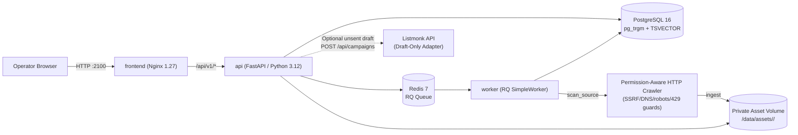

# SwipeVault — Architecture (Phases 0–3)

## Overview

SwipeVault separates offer discovery, permission-aware resource collection, asset ingestion, deterministic swipe extraction, editorial review, and campaign draft preparation / Listmonk unsent draft export.

## Components

1. **`frontend` (React 18 + TypeScript + Vite + Tailwind CSS, served by Nginx):**
   - Reverse-proxies `/api/` to `http://api:8000` so the browser only communicates with a single origin.
   - Sends double-submit `X-CSRF-Token` headers from the `sv_csrf` cookie on all state-changing requests.
   - Renders sanitized HTML previews inside `<iframe sandbox="" srcdoc="...">` with an inline Content Security Policy (`default-src 'none'; style-src 'unsafe-inline'; img-src data:`).
   - Provides full workflows for Overview, Offers + CSV Import, Offer Detail + Source Scanning + Authorized Upload, Swipe Library, Review Queue (`j/k/a/r/n` keyboard navigation), Campaign Drafts + Listmonk Draft Export, Jobs, and Brand Profiles / Settings.
2. **`api` (FastAPI + SQLAlchemy 2.0 + Alembic):**
   - Runs `alembic upgrade head` (`0001_foundation` -> `0002_collection_and_drafts`) on startup and bootstraps the initial admin user if `BOOTSTRAP_ADMIN_EMAIL` and `BOOTSTRAP_ADMIN_PASSWORD` are set.
   - Enforces Argon2id password verification, server-side session tokens (HMAC-SHA256 hashed in `sessions`), double-submit CSRF tokens, login rate limiting, URL/SSRF validation, magic-byte file verification, per-offer/per-source scan locking (`FR-09`), and version-specific draft approvals (`AC-11`).
3. **`worker` (Redis + RQ `SimpleWorker`):**
   - Executes `ingest_asset` and `scan_source` jobs asynchronously with non-root user `10001:10001` and dedicated CPU/memory limits.
   - On startup, `recover_interrupted_jobs()` safely re-queues and re-runs any job interrupted mid-execution (`state = 'running'`).
   - Supports inline execution (`INGEST_INLINE=true`) for deterministic test runs or single-process fallback if Redis is temporarily unavailable.
4. **`postgres` (PostgreSQL 16 Alpine):**
   - Enables `pg_trgm` and `pgcrypto`.
   - Enforces composite foreign key `fk_swipes_current_version_belongs` so `swipes.current_version_id` is guaranteed to belong to the same `swipe_id`.
   - Maintains a persisted `TSVECTOR` column (`swipes.search_tsv`) plus trigram GIN indexes on `swipes.search_document`, `swipe_versions.body_text`, `subject_variants.subject`, and `offers.title`.
   - Stores `brand_profiles` (seeded with **MyFitterU**), versioned `drafts` (`version`, `approved_version`, `review_checks_json`), and idempotent `exports` (`idempotency_key`, `status IN ('pending', 'completed', 'failed', 'needs_reconciliation')`).
5. **Listmonk Draft Adapter (`app/adapters/listmonk/client.py`):**
   - Disabled by default (`LISTMONK_ENABLED=false`) with always-on local HTML/plain-text download fallback (`/api/v1/drafts/{id}/download?format=html|txt`).
   - When enabled, validates connectivity via `GET /api/lists` and creates unsent draft campaigns via `POST /api/campaigns` using deterministic idempotency keys (`sha256("listmonk:{draft_id}:v{version}:lists={sorted_list_ids}")`). Contains zero methods for starting, scheduling, or sending campaigns.
