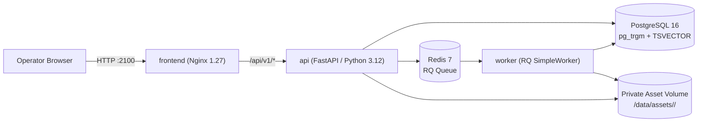

# SwipeVault — Architecture (Phase 0 & Phase 1)

## Overview

SwipeVault separates offer discovery, asset ingestion, deterministic swipe extraction, editorial review, and (Phase 3) campaign draft preparation.

## Components

1. **`frontend` (React 18 + TypeScript + Vite + Tailwind CSS, served by Nginx):**
   - Reverse-proxies `/api/` to `http://api:8000` so the browser only communicates with a single origin.
   - Sends double-submit `X-CSRF-Token` headers from the `sv_csrf` cookie on all state-changing requests.
   - Renders sanitized HTML previews inside `<iframe sandbox="" srcdoc="...">` with an inline Content Security Policy (`default-src 'none'; style-src 'unsafe-inline'; img-src data:`).
2. **`api` (FastAPI + SQLAlchemy 2.0 + Alembic):**
   - Runs `alembic upgrade head` on startup and bootstraps the initial admin user if `BOOTSTRAP_ADMIN_EMAIL` and `BOOTSTRAP_ADMIN_PASSWORD` are set.
   - Enforces Argon2id password verification, server-side session tokens (HMAC-SHA256 hashed in `sessions`), double-submit CSRF tokens, login rate limiting, URL/SSRF validation, and magic-byte file verification.
3. **`worker` (Redis + RQ `SimpleWorker`):**
   - Executes `ingest_asset` jobs asynchronously with non-root user `10001:10001` and dedicated CPU/memory limits.
   - On startup, `recover_interrupted_jobs()` safely re-queues and re-runs any job interrupted mid-execution (`state = 'running'`).
   - Supports inline execution (`INGEST_INLINE=true`) for deterministic test runs or single-process fallback if Redis is temporarily unavailable.
4. **`postgres` (PostgreSQL 16 Alpine):**
   - Enables `pg_trgm` and `pgcrypto`.
   - Enforces composite foreign key `fk_swipes_current_version_belongs` so `swipes.current_version_id` is guaranteed to belong to the same `swipe_id`.
   - Maintains a persisted `TSVECTOR` column (`swipes.search_tsv`) plus trigram GIN indexes on `swipes.search_document`, `swipe_versions.body_text`, `subject_variants.subject`, and `offers.title`.

## Deterministic Extraction & Versioning Lifecycle

1. **Content-addressed storage (`app/services/storage.py`):**
   - Every uploaded file and archive entry is hashed with SHA-256 and stored once at `/data/assets/<sha[:2]>/<sha256>`.
2. **Lineage tracking (`asset_sources.lineage_key`):**
   - Standalone uploads get `lineage_key = "file:<lowercase_filename>"`.
   - ZIP entries get `lineage_key = "file:<zip_filename>::<entry_path>"`.
3. **Deduplication & versioning (`app/services/ingestion.py`):**
   - **Unchanged asset (`AC-04`):** If `(offer_id, asset_id, lineage_key)` already exists and is extracted, no duplicate asset or swipe is created.
   - **Exact duplicate swipe within offer (`FR-05 #2`):** If `normalized_hash` (SHA-256 of sorted NFKC-normalized subjects + normalized body) matches an existing `SwipeVersion` for the offer, a new `SwipeProvenance` reference is attached without duplicating the swipe.
   - **Revised document (`AC-05`):** When an asset with the same `(offer_id, lineage_key)` has new bytes and a swipe block with the same `identity_key` (e.g. `email 1: digest tea`) has a new `normalized_hash`, SwipeVault creates `version_number = N + 1`, updates `current_version_id`, resets `review_state = 'pending'`, and preserves `v1..vN` and their `review_events`.
